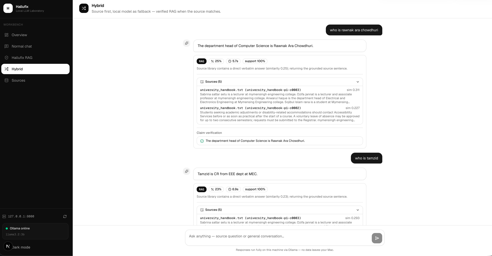

<h1 align="center">TrustRAG</h1>

<p align="center">
  <strong>Stop AI hallucination in Retrieval-Augmented Generation — with strict, source-grounded answers that abstain instead of guessing.</strong><br/>
  Fully local · No API keys · Privacy-first
</p>

<p align="center">
  <a href="#"></a>
  <a href="#"></a>
  <a href="#"></a>
  <a href="https://github.com/fahimistiaq456-eng/TrustRAG/actions"></a>
  <a href="https://github.com/fahimistiaq456-eng"></a>
  <a href="#"></a>
</p>
<p align="center">
  <a href="#-why-trustrag">Why TrustRAG</a> ·
  <a href="#-features">Features</a> ·
  <a href="#-architecture">Architecture</a> ·
  <a href="#-tech-stack">Tech Stack</a> ·
  <a href="#-quick-start">Quick Start</a> ·
  <a href="#-run">Run</a> ·
  <a href="#-author--maintainer">Author</a> ·
  <a href="#-configuration">Configuration</a> ·
  <a href="#-api">API</a> ·
  <a href="#-testing--evaluation">Testing</a> ·
  <a href="#-license">License</a>
</p>

---

## 👤 Author & Maintainer

<p align="center">
  <strong>Md. Fahim Istiaq Siam</strong><br/>
  🔗 <strong>GitHub:</strong> <a href="https://github.com/fahimistiaq456-eng">@fahimistiaq456-eng</a> &nbsp;|&nbsp; 📦 <strong>Repository:</strong> <a href="https://github.com/fahimistiaq456-eng/TrustRAG">TrustRAG</a><br/>
  <em>Focus: Local-First RAG Architecture · Evidence Grounding · Hallucination Abstention · NLI Verification</em>
</p>

---

<h3 align="center"> -- Preview of the app -- </h3>
<p align="center">
  
</p>

## ✨ Why TrustRAG?

RAG is supposed to ground an LLM's answer in real source documents — but it is _not automatically reliable_. Classical RAG lets the model read retrieved passages and then **paraphrase, expand, and "polish"** them. That freedom is exactly where hallucinations creep back in: a model merges unrelated facts, infers a person's expertise from a course syllabus, or invents responsibilities from a job title.

**TrustRAG takes a fundamentally stricter stance:**

```
Retrieve  →  Select the exact, relevant source sentence  →  Return it verbatim  →  Verify → Abstain if unsupported
```

HalluFix does not try to sound clever. It answers **only** from what your documents actually state, and when the source does not answer the question, it **abstains** instead of guessing.

> **“Less information + higher evidence support = a better answer.”**
> — the core design principle of HalluFix.

---

## 🧩 Features

- **🧠 Strict evidence-first generation** — the answer is a _real sentence_ from your source, returned verbatim. No LLM paraphrase, expansion, or stylistic polish.
- **⛔ Aspect-gated abstention** — if a question targets a fact the source omits (e.g. _“What research does X do?”_), HalluFix abstains rather than hallucinate.
- **🔎 FAISS semantic retrieval** — fast, normalized cosine-similarity search over chunks with `all-MiniLM-L6-v2`, running locally on CPU.
- **⚡ Cross-encoder reranking** _(optional)_ — reorders candidates with a `(question, passage)` cross-encoder for better recall.
- **🕸 Graph-based retrieval** _(optional)_ — a local `networkx` knowledge graph surfaces facts spread across multiple chunks, always with source provenance.
- **✅ NLI claim verification** — every claim is checked via a deterministic fast-path → dedicated Natural Language Inference model → strict LLM fallback; unsupported claims are removed.
- **🔀 Hybrid routing** — source-first with a sensible local-LLM fallback and confident abstention.
- **🏷 Multi-domain benchmarking** — evaluate on `university`, `healthcare`, `technology`, `law`, and `finance` datasets, and compare configurations head-to-head.
- **👥 Human evaluation framework** — rubric-based scoring with inter-rater agreement (Cohen's κ) and honest sample-size reporting.
- **🔐 Authentication & RBAC** _(optional)_ — JWT + SQLite with `ADMIN` / `EVALUATOR` / `USER` roles.
- **📑 Citations & audit logs** — every answer carries its source and every run is recorded for reproducibility.
- **🖥 Two frontends** — a modern Next.js dashboard (recommended) plus a legacy Streamlit UI.

---

## 🏗 Architecture

```
         User Question
              │
   ┌──────────▼──────────┐
   │ FAISS candidate      │   (all-MiniLM-L6-v2, cosine-similarity)
   │ retrieval            │
   └──────────┬───────────┘
              │  optional
   ┌──────────▼──────────┐
   │ Graph retrieval      │   (networkx, provenance-backed)
   └──────────┬───────────┘
   ┌──────────▼──────────┐
   │ Cross-encoder        │   (optional) reranking → top-N evidence
   │ reranking            │
   └──────────┬───────────┘
   ┌──────────▼──────────┐
   │ Abstention gate      │   low evidence ⇒ abstain
   └──────────┬───────────┘
   ┌──────────▼──────────┐
   │ Extractive generator  │   select the exact source sentence, return verbatim
   └──────────┬───────────┘
   ┌──────────▼──────────┐
   │ Claim verification    │   deterministic → NLI → strict LLM fallback
   └──────────┬───────────┘
   ┌──────────▼──────────┐
   │ Presentation-layer    │   formatting ONLY — never adds facts
   │ formatting            │
   └──────────┬───────────┘
    Answer + Sources + Citations
              │
              ▼
          Audit Log
```

---

## 🖥 Tech Stack

| Layer                        | Technology                                                         |
| ---------------------------- | ------------------------------------------------------------------ |
| API                          | **Python 3.11 + FastAPI**                                          |
| Embeddings                   | `sentence-transformers/all-MiniLM-L6-v2`                           |
| Vector search                | **FAISS** (normalized `IndexFlatIP`)                               |
| Reranker _(optional)_        | `cross-encoder/ms-marco-MiniLM-L-6-v2`                             |
| NLI _(optional)_             | `cross-encoder/nli-MiniLM2-L6-H768`                                |
| Local LLM                    | **Ollama** (`llama3.2:3b` default)                                 |
| Knowledge graph _(optional)_ | **networkx**                                                       |
| Auth                         | **JWT + SQLite** (PBKDF2 password hashing)                         |
| Frontend                     | **Next.js** (React · Tailwind · App Router) + legacy **Streamlit** |
| Evaluation                   | custom multi-domain runner + human-evaluation metrics              |

---

## 🚀 Quick Start

### Prerequisites

- **Python 3.11+**
- **Node.js 18+** & npm _(for the Next.js webapp)_
- **[Ollama](https://ollama.com)** with a small local model, e.g. `ollama pull llama3.2:3b`

### 1. Clone & install

```bash
git clone <your-repo-url> Hallufix
cd Hallufix

python3.11 -m venv .venv
source .venv/bin/activate
pip install -r requirements.txt
cp .env.example .env

# Next.js webapp (after cloning)
cd webapp && npm install && cd ..
```

### 2. Fetch the local model (once)

```bash
ollama serve              # Terminal 1
ollama pull llama3.2:3b   # Terminal 2 (once)
```

### 3. Build the index from your documents

```bash
# Index every .txt/.pdf in data/ (a synthetic university handbook is included)
python -m backend.build_index data

# …or point at any folder of TXT/PDF files:
python -m backend.build_index path/to/your/sources
```

Your documents must be under `data/sources/` — the **Sources** tab in the webapp handles uploads and re-indexing for you.

---

## ▶️ Run

The easiest way is the launcher scripts (they create the venv, copy `.env`, install deps, start Ollama, and build the index on first run):

### Windows (One-Click Launchers)
```powershell
# In PowerShell:
.\run_all.ps1

# Or double-click / run batch script in Command Prompt:
run_all.bat
```

### Linux / macOS
```bash
./run_backend.sh          # FastAPI on :8000
./run_frontend.sh         # Next.js webapp on :3000

# or start both together:
./run_all.sh              # background both, logs in logs/
./run_all.sh --status     # show what's running
./run_all.sh --stop       # stop everything
```

Now open the webapp:

> ### 🖥 **http://localhost:3000**

**Webapp views**

- **Overview** — backend + model status and pipeline comparison
- **Normal chat** — the local model, no retrieval
- **HalluFix RAG** — evidence-first, verified source answers
- **Hybrid** — source-first with local-LLM fallback
- **Sources** — upload PDF/TXT documents and re-index

<details>
<summary><b>Manual start</b></summary>

```bash
# Terminal 1 — backend
uvicorn backend.api:app --reload        # http://127.0.0.1:8000

# Terminal 2 — Next.js webapp (recommended)
cd webapp && npm run dev                # http://localhost:3000

# Terminal 2 alternative — legacy Streamlit UI
streamlit run frontend/app.py           # http://localhost:8501
```

## </details>

## ⚙️ Configuration

All behaviour is centralized in `backend/config.py` and driven by `HALLUFIX_*` environment variables (see [`.env.example`](.env.example)). The most important ones:

| Variable                                | Default                                  | Description                            |
| --------------------------------------- | ---------------------------------------- | -------------------------------------- |
| `HALLUFIX_INDEX_DIR`                    | `data/index`                             | FAISS index + graph persistence        |
| `HALLUFIX_ABSTENTION_THRESHOLD`         | `0.25`                                   | Minimum similarity to avoid abstaining |
| `HALLUFIX_OLLAMA_HOST` / `_MODEL`       | `http://127.0.0.1:11434` / `llama3.2:3b` | Local LLM                              |
| `HALLUFIX_RERANKER_ENABLED`             | `false`                                  | Enable cross-encoder reranking         |
| `HALLUFIX_RERANK_CANDIDATES` / `_TOP_N` | `10` / `5`                               | Candidate vs. kept evidence count      |
| `HALLUFIX_NLI_ENABLED`                  | `false`                                  | Enable NLI claim verification          |
| `HALLUFIX_NLI_ENTAILMENT_THRESHOLD`     | `0.70`                                   | NLI entailment confidence gate         |
| `HALLUFIX_GRAPH_ENABLED`                | `false`                                  | Enable graph-based retrieval           |
| `HALLUFIX_AUTH_ENABLED`                 | `false`                                  | Enable JWT auth + RBAC                 |
| `HALLUFIX_JWT_SECRET`                   | `change-me`                              | **Override in any real deployment**    |

Optional stages **default off** and **degrade gracefully** — if a reranker, NLI model, or graph is unavailable, the pipeline simply continues with plain FAISS RAG.

---

## 🔌 API

Core endpoints under `POST /ask`, `POST /chat/normal`, `POST /chat/hybrid`, `POST /ingest`, `GET /sources`, `GET /health` — plus auth, admin, and evaluation routes.

```bash
curl -X POST http://localhost:8000/ask \
  -H 'content-type: application/json' \
  -d '{"question":"How many credits are required to graduate?"}'
```

Unanswerable questions return `abstained: true` with `Insufficient information available in the university handbook.` rather than a guess.

---

## 🧪 Testing & Evaluation

```bash
pytest                          # full backend + feature test suite (72 passing)
npm run lint && npm run build   # (in webapp/)

# Multi-domain benchmark
python -m evaluation.evaluate --domain university
python -m evaluation.evaluate --all
python -m evaluation.evaluate --offline --all   # offline (metrics reported as N/A)
```

## Results are written to `evaluation/results/results.json` (JSON) and `evaluation/results/report.md`. Human-evaluation records live in `evaluation/human/evaluations.jsonl`. See the [Testing Report](docs/TEST_REPORT.md) for details.

## 📁 Project Structure

```text
Hallufix/
├── backend/       ingestion, FAISS + graph storage, retrieval, reranking, NLI,
│                  generation, hybrid decision, verification, auth/RBAC, API, config
├── webapp/        Next.js (React + Tailwind + App Router) frontend
├── frontend/      legacy Streamlit interface
├── evaluation/    multi-domain datasets + runner + metrics + human-evaluation framework
├── data/          sources, local index, graph, SQLite DB
├── docs/          architecture + feature documentation
├── assets/        project cover / banner artwork
├── logs/          append-only JSON audit records + hybrid decisions
└── tests/         unit + integration tests for every feature
```

---

## 📚 Documentation

- [Architecture overview](docs/architecture.md)
- [Cross-encoder reranking](docs/reranking.md)
- [NLI verification](docs/nli-verification.md)
- [Graph-based retrieval](docs/graph-retrieval.md)
- [Multi-domain evaluation](docs/multi-domain-evaluation.md)
- [Human evaluation framework](docs/human-evaluation.md)
- [Authentication & RBAC](docs/authentication.md)
- [Hybrid pipeline](docs/HYBRID_PIPELINE.md)
- [Natural generation pipeline](docs/NATURAL_GENERATION_PIPELINE.md)
- [Testing report](docs/TEST_REPORT.md)

---

## 🗺 Roadmap

- [x] Strict evidence-first answer generation
- [x] Cross-encoder reranking
- [x] Dedicated NLI verification
- [x] Multi-domain benchmarking
- [x] Graph-based retrieval
- [x] Human-evaluation framework
- [x] Authentication / RBAC
- [x] GitHub Actions CI (lint, test, build)
- [x] Windows native launch scripts (.bat / .ps1)
- [ ] Reranking / NLI / graph dashboards in the Next.js UI
- [ ] Evaluation comparison dashboard in the webapp

---

## 🤝 Contributing

Contributions are welcome! Please:

1. **Fork** the repository.
2. Create a feature **branch** (`git checkout -b feat/your-idea`).
3. Write **tests** for your change (`pytest`).
4. Open a **pull request**.

Ensure the test suite stays green: `pytest` and `npm run lint && npm run build`.

---

---

## 📄 License

This project is released under the [MIT License](LICENSE).

---

<p align="center">
  Developed & Maintained by <strong><a href="https://github.com/fahimistiaq456-eng">Md. Fahim Istiaq Siam</a></strong><br/>
  Mitigating AI Hallucination with Evidence-First RAG in a Local, Privacy-Friendly Architecture.<br/>
  Built with ❤️ and <code>NO Api keys required</code>.
</p>
